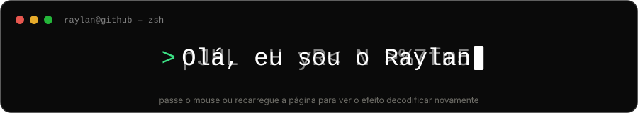
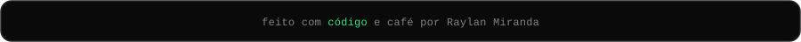

  

<h2 align="center">Olá 👋</h2>

  Sou estudante de <b>Análise e Desenvolvimento de Sistemas (ADS)</b> e desenvolvedor focado em criar aplicações web práticas, rápidas e com excelente experiência de usuário. Gosto de tirar ideias do papel para resolver problemas reais — desde sistemas de gestão comercial e cardápios digitais até aplicativos de saúde e plataformas de campanhas online.

  📍 Ponta Grossa, PR &nbsp;|&nbsp; 💼 Em busca de oportunidades como <b>Desenvolvedor / Analista de Sistemas / Suporte Técnico</b>

### Sobre Mim

- 🖥️ Técnico de suporte e desenvolvedor na **Call ECG Serviços de Telemedicina**
- 💻 Desenvolvedor web freelancer — **React, Next.js, TypeScript e Supabase**
- 🎓 Cursando **Análise e Desenvolvimento de Sistemas** (conclusão prevista em 2027)
- 🚀 Sempre em busca de novos desafios e aprendizados em tecnologia

### 🛠️ Tecnologias e Ferramentas

**Front-end & Mobile**

**Back-end, Banco de Dados & Cloud**

### 🚀 Principais Projetos em Destaque

- 🍔 **[RGM Pedidos](https://github.com/RaylanGabriel/rgm-pedidos)** — Plataforma de cardápio digital e gerenciamento de pedidos e combos.
- 🥗 **[MyDiet](https://github.com/RaylanGabriel/mydiet)** — App de acompanhamento nutricional (baseado nas tabelas TACO/TBCA e análise por IA) e divisão de treinos (A/B/C).
- 🎟️ **[RifaSorte](https://sistema-rifas-sorte.vercel.app/)** — Sistema de rifas solidárias e crowdfunding humanizado com gestão de reservas em tempo real.
- 🍀 **[SmartLucky](https://github.com/RaylanGabriel/smartlucky)** — Aplicação web desenvolvida em TypeScript.
- 🎓 **[Educonnect](https://github.com/RaylanGabriel/Educonnect)** — Projeto de imersão profissional construído em Java.

### 📊 Estatísticas no GitHub

  
  

### 📫 Vamos nos Conectar!

  
  
  

Fique à vontade para se conectar ou enviar uma mensagem! 😊

  

